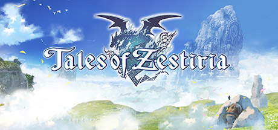

**Tales of Zestiria follows shepherd Sorey who can see and fuse with Seraphs, supernatural beings invisible to most humans. Features the Armitization system for fusing with Seraph partners in battle and an open world filled with malevolence corrupting the land.**

---

## 📖 About

Tales of Zestiria follows shepherd Sorey who can see and fuse with Seraphs, supernatural beings invisible to most humans. Features the Armitization system for fusing with Seraph partners in battle and an open world filled with malevolence corrupting the land.

## ⚠️ Problems Without Trainer

| Problem | Status |
|---------|--------|
| **Malevolence System** — High malevolence areas spawn stronger enemies that can overwhelm parties | ✅ Solved |
| **Arte Combo Timing** — Chaining Artes during Armitization has a strict timing rhythm | ✅ Solved |
| **Normin Collection** — Finding all 55 Normin requires exhaustive world exploration | ✅ Solved |
| **Rose's Route** — Some story choices permanently affect roster availability | ✅ Solved |

## ✅ Solution

The **Tales of Zestiria Trainer** solves all these issues by giving you complete control over the game.

## 🎯 Full Feature List

- Unlimited Resources
- God Mode / Invincibility
- Instant Skill Cooldown
- One-Hit Kill
- Freeze Game Timer
- Unlock All Items & Achievements
- Custom Speed Multiplier
- Save State Anywhere

## 🚀 Quick Start

1. **Disable Windows Defender** temporarily (trainer may trigger false positive)
2. Download the trainer from the button above
3. Launch Tales of Zestiria
4. Run the trainer as Administrator
5. Activate desired cheats with hotkeys

## 💎 Free vs Paid

| Feature | Free | Pro |
|---------|------|-----|
| Basic God Mode | ✅ | ✅ |
| Unlimited Resources | ✅ | ✅ |
| All Advanced Cheats | ❌ | ✅ |
| Auto-Updates | ❌ | ✅ |
| Priority Support | ❌ | ✅ |

## 💻 Requirements

- Windows 10/11 (64-bit)
- Tales of Zestiria (any version)
- .NET Framework 4.8+
- DirectX 11+

## 🍎 macOS

macOS users can use our alternative tool:

## ⚖️ Legal

This trainer is for educational and single-player use only. Use responsibly.

---

